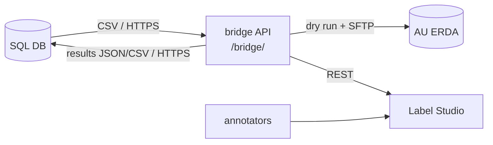

# wildcam-ls-bridge

A secure two-way connection between the **wildcam video database** and **Label Studio**:

1. **In**: a client POSTs a CSV (output of an SQL query) to an HTTPS API.
2. The bridge runs a **dry run**: it logs in to **AU ERDA** over SFTP, checks every file
   exists, and checks there is enough disk space.
3. It downloads the videos over SFTP into `~/labelstudio-data/bridge/<job_id>/`.
4. It creates a **Label Studio project** with the team's labeling UI and the model's guess
   pre-filled.
5. Humans annotate in Label Studio.
6. **Out**: the client fetches progress and **annotation results** (JSON or CSV) from the same API.

All transfers are encrypted (HTTPS / SSH). The API requires an API key, is rate-limited, and
is reachable only through nginx/TLS.



## Quick start (client)

```bash
export BRIDGE_URL=https://wildcam.ecoscience.dk/bridge BRIDGE_API_KEY=wcb_...
curl -sS -X POST "$BRIDGE_URL/api/v1/jobs" -H "Authorization: Bearer $BRIDGE_API_KEY" \
     -F file=@query.csv -F title="My batch"                              # → {"id": "...", ...}
curl -sS "$BRIDGE_URL/api/v1/jobs/<id>"          -H "Authorization: Bearer $BRIDGE_API_KEY"
curl -sS "$BRIDGE_URL/api/v1/jobs/<id>/results?format=csv" -H "Authorization: Bearer $BRIDGE_API_KEY"
curl -sS -X DELETE "$BRIDGE_URL/api/v1/jobs/<id>?force=true" -H "Authorization: Bearer $BRIDGE_API_KEY"  # when done
```

## Quick start (server)

```bash
uv sync && cp .env.example .env && chmod 600 .env    # fill in the secrets
uv run wildcam-bridge check                          # LS token, ERDA login, disk
uv run wildcam-bridge dry-run ~/resources/test_query.csv
sudo deploy/install.sh                               # systemd + nginx /bridge/
```

## Documentation

| Document | For |
|---|---|
| [docs/user-guide.md](docs/user-guide.md) | **API users**: endpoints, curl and Python examples, result columns, errors |
| [docs/dev-guide.md](docs/dev-guide.md) | **administrators/developers**: architecture, install on a new server, operations, tests |
| [docs/reference/](docs/reference/) | knowledge collected while building: [server inventory](docs/reference/server-inventory.md), [ERDA](docs/reference/erda.md), [CSV schema](docs/reference/csv-schema.md), [Label Studio notes and UI template](docs/reference/label-studio-notes.md) |
| [journal/](journal/README.md) | work log, one entry per task |

## Repository layout

```
config/            label_config.xml (team UI template), erda_known_hosts (pinned ERDA key)
deploy/            nginx snippet + rate limit, systemd unit, install.sh
docs/              user guide, dev guide, reference notes
journal/           work log
scripts/           check_no_secrets.py (pre-commit)
src/wildcam_bridge application code
tests/             unit/ (+ integration with fake SFTP), e2e/ (real Label Studio), fixtures/
.env.example       configuration template (copy to .env, git-ignored)
```

## Development

`make all` (lint, mypy --strict, tests, secret scan) · `make e2e` · see the
[dev guide](docs/dev-guide.md#5-development).
