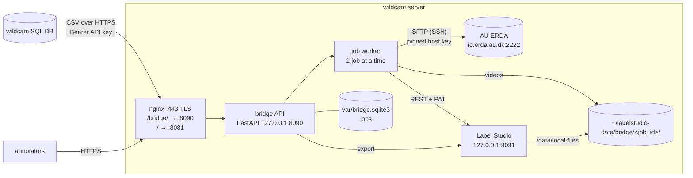

# Developer guide: deploying and maintaining the bridge

How to install the bridge on a new server, how it works, and how to operate and extend it.
API usage is in [user-guide.md](user-guide.md).

## 1. Architecture



Encryption in transit: CSV upload and results download use **HTTPS** (nginx + Let's Encrypt).
Videos from ERDA use **SFTP/SSH**. Bridge ↔ Label Studio traffic stays on the loopback
interface.

Code map (`src/wildcam_bridge/`):

| Module | Role |
|---|---|
| `settings.py` | all configuration (`.env`), secrets as `SecretStr` |
| `csv_ingest.py` | CSV validation and grouping into `MediaItem`s |
| `paths.py` | **path safety** (no traversal), CSV path → ERDA path → local path → LS URL |
| `erda.py` | SFTP session (pinned key), **dry run**, resumable concurrent download with retries |
| `label_config.py` | parse the labeling UI XML |
| `tasks.py` | build LS tasks + model pre-annotations |
| `labelstudio.py` | LS REST client (PAT refresh flow) |
| `results.py` | flatten LS export into rows / CSV |
| `jobs.py` | SQLite job store, single worker thread |
| `pipeline.py` | orchestration of one job |
| `api.py` | FastAPI app: auth, HTTPS enforcement, endpoints |
| `client.py`, `cli.py` | Python client, `wildcam-bridge` command line |

Design decisions:

* **One worker, sequential jobs**: two parallel jobs could both pass the disk-space check and
  then fill the disk together.
* **Dry run before every download**: login, size of every remote file, free disk minus
  `DISK_RESERVE_GB`. Missing files fail the job unless `allow_missing=true`.
* **Per-job folder and per-job LS local storage**: Label Studio only serves a file when a
  local storage of a project the user can access has a path that is a prefix of the file's
  folder (see [reference/label-studio-notes.md](reference/label-studio-notes.md)).
* **Tasks imported through the API** (not storage sync): synchronous, returns counts,
  idempotent on retry (skipped when the project already has tasks).
* **Pre-annotations**: the model label becomes a prediction on `species_label` and
  `show_collab_predictions` is enabled, so the annotator sees the guess pre-filled.

## 2. Install on a new server

### Prerequisites

* Ubuntu/Debian with `nginx`, `certbot` (`python3-certbot-nginx`), `git`, `curl`
  (and optionally `make`).
* A DNS name pointing to the server (here `wildcam.ecoscience.dk`).
* [`uv`](https://docs.astral.sh/uv/): `curl -LsSf https://astral.sh/uv/install.sh | sh`.
* Outbound TCP **2222** to `io.erda.au.dk`.

### Step 1: Label Studio (if not already installed)

```bash
sudo adduser wildcam                      # service user
sudo -iu wildcam
mkdir -p ~/labelstudio ~/labelstudio-data && cd ~/labelstudio
uv venv --python 3.12 && uv pip install label-studio      # tested with 1.23.0
```

Create `/etc/systemd/system/wildcam.service` as in
[reference/server-inventory.md](reference/server-inventory.md) (`--host 127.0.0.1 --port 8081`,
`LABEL_STUDIO_LOCAL_FILES_SERVING_ENABLED=true`,
`LABEL_STUDIO_LOCAL_FILES_DOCUMENT_ROOT=/home/wildcam/labelstudio-data`,
`CSRF_TRUSTED_ORIGINS=https://<domain>`, `LABEL_STUDIO_DISABLE_SIGNUP_WITHOUT_LINK=true`), then:

```bash
sudo systemctl daemon-reload && sudo systemctl enable --now wildcam
```

nginx site `/etc/nginx/sites-available/wildcam` with `location / { proxy_pass http://127.0.0.1:8081; ... }`
(see the inventory), `sudo ln -s ../sites-available/wildcam /etc/nginx/sites-enabled/`,
then `sudo certbot --nginx -d <domain>` for TLS. Create the first LS user (admin) in the browser.

### Step 2: Label Studio service account + token

1. In Label Studio, as admin: *Organization → Add People* → copy the invite link.
2. Open the link in a private window, sign up as e.g. `bridge-bot@<your domain>` with a strong
   password (store it in your password manager). **No real mailbox is needed:** Label Studio
   Community sends no email (`EMAIL_BACKEND` defaults to Django's dummy backend), so the
   address is only a login name. Use a domain you control so nobody else can claim it. A
   lost password can be reset on the server with
   `label-studio reset_password --username <email> --password <new>` (as the LS user).
3. As that user: *Account & Settings → Personal Access Token → Create*. Copy the token
   (shown once).

Projects created by the bridge are owned by this account. Everyone in the organization can
see and annotate them (Community edition).

### Step 3: the bridge

```bash
sudo -iu wildcam
git clone <repo-url> ~/wildcam-ls-bridge && cd ~/wildcam-ls-bridge
uv sync                                   # creates .venv (runtime + dev tools)
cp .env.example .env && chmod 600 .env
nano .env                                 # ERDA_SHARELINK, LS_API_TOKEN, LS_* paths
uv run wildcam-bridge gen-api-key         # once per client; put the sha256:… in BRIDGE_API_KEY_HASHES
```

Pin and **verify** the ERDA host key (compare the fingerprint with
[reference/erda.md](reference/erda.md) or ERDA support):

```bash
ssh-keyscan -p 2222 io.erda.au.dk > config/erda_known_hosts
ssh-keygen -lf config/erda_known_hosts
```

Check everything, then do a dry run with a real CSV:

```bash
uv run wildcam-bridge check                       # label config, API keys, LS token, ERDA, disk
uv run wildcam-bridge dry-run /path/to/query.csv  # nothing is downloaded
```

### Step 4: service + nginx (needs sudo)

```bash
sudo deploy/install.sh
# NGINX_SITE=/etc/nginx/sites-available/<site> to override the site file
```

The script:

* writes `/etc/systemd/system/wildcam-bridge.service` from `deploy/systemd/` (hardened:
  read-only filesystem except `var/` and `labelstudio-data/bridge/`);
* installs `deploy/nginx/wildcam-bridge.conf` as `/etc/nginx/snippets/wildcam-bridge.conf`
  and the rate-limit zone in `/etc/nginx/conf.d/`;
* adds `include /etc/nginx/snippets/wildcam-bridge.conf;` to the TLS server block (with a backup;
  restores the backup if `nginx -t` fails);
* reloads nginx and calls `https://<domain>/bridge/healthz`.

Manual alternative: copy the two files, add the `include` line inside the
`server { listen 443 ssl; ... }` block, then `sudo nginx -t && sudo systemctl reload nginx`.

## 3. Configuration reference

All settings live in `.env` (documented in [`.env.example`](../.env.example)). The three
secrets are `ERDA_SHARELINK`, `LS_API_TOKEN` and `BRIDGE_API_KEY_HASHES` (hashes only, but
treat them as sensitive). `.env` is git-ignored, and a pre-commit hook blocks commits that
contain any secret value from `.env`.

| Variable | Default | |
|---|---|---|
| `BRIDGE_HOST` / `BRIDGE_PORT` | `127.0.0.1` / `8090` | keep loopback |
| `BRIDGE_ROOT_PATH` | `/bridge` | public prefix (must match nginx) |
| `BRIDGE_REQUIRE_HTTPS` | `true` | refuse requests without `X-Forwarded-Proto: https` |
| `ERDA_STRIP_PREFIX` | `wildcams/` | removed from the CSV `file` column |
| `ERDA_REMOTE_ROOT` | "" | folder in the share holding those paths |
| `ERDA_CONCURRENCY` / `ERDA_RETRIES` | 8 / 3 | retry passes reconnect and halve concurrency |
| `LS_DATA_ROOT` | `/home/wildcam/labelstudio-data` | = `LABEL_STUDIO_LOCAL_FILES_DOCUMENT_ROOT` |
| `DISK_RESERVE_GB` | 10 | must stay free after a download |
| `LS_URL` | `http://127.0.0.1:8081` | internal URL |
| `LS_PUBLIC_URL` | `https://wildcam.ecoscience.dk` | used for `project_url` |

## 4. Operations

```bash
systemctl status wildcam-bridge                    # service state
journalctl -u wildcam-bridge -f                    # logs (job progress, errors)
uv run wildcam-bridge check                        # connectivity self-test
sqlite3 var/bridge.sqlite3 'select id,status,error from jobs order by created_at desc limit 10'
```

* **Retry a failed job:** `POST /api/v1/jobs/{id}/retry` (completed files are not
  downloaded again; an existing project is reused).
* **Restart:** jobs interrupted by a restart become `failed` and can be retried.
* **Add or revoke a client:** `uv run wildcam-bridge gen-api-key`, then add or remove the
  hash in `BRIDGE_API_KEY_HASHES` and `sudo systemctl restart wildcam-bridge`.
* **Rotate the LS token:** create a new PAT for the service account, update `LS_API_TOKEN`,
  restart.
* **Rotate the ERDA sharelink:** update `ERDA_SHARELINK`, restart.
* **ERDA host key changed:** the job fails with *host key does not match*. Verify the new
  fingerprint out-of-band, re-pin (see [reference/erda.md](reference/erda.md)), commit.
* **Free disk space:** once a project is fully annotated and the results are exported, delete
  the project in Label Studio, then `rm -r ~/labelstudio-data/bridge/<job_id>`. Uploaded CSVs
  are in `var/jobs/<job_id>/input.csv`.
* **Check the model pre-fill of a project:**
  `uv run python scripts/verify_prefill.py query.csv <project_id>` (every task's prediction is
  compared with its CSV row; exit code 0 = all pre-filled as expected).
* **Run the pipeline without the API** (debugging):
  `uv run wildcam-bridge run query.csv --title "..."`.

## 5. Development

```bash
uv sync && uv run pre-commit install
make all          # = lint + typecheck + test + secret scan
make e2e          # end-to-end with a throw-away Label Studio (~2 min)
make cov          # coverage
```

Without `make` (it is not installed on the production server):

```bash
uv run ruff check src tests scripts && uv run ruff format --check src tests scripts
uv run mypy                      # strict
uv run pytest                    # unit + integration (fake SFTP server, fake LS), ~10 s
uv run pytest -m e2e             # real Label Studio + fake SFTP
uv run pytest --cov
```

Test layers:

| Layer | Where | What is real |
|---|---|---|
| unit | `tests/unit/test_{paths,csv_ingest,label_config_and_tasks,results,auth_settings,jobs,labelstudio_client}.py` | pure functions, HTTP mocked with `httpx.MockTransport` |
| integration | `tests/unit/test_erda.py`, `test_api.py`, `test_client_cli.py` | a real asyncssh SFTP server in-process (pinned key, sharelink login, flaky reads), the real FastAPI app, an in-memory LS fake |
| end-to-end | `tests/e2e/test_round_trip.py` | a **real Label Studio** started from `~/labelstudio/.venv` on a free port with its own data dir (production untouched): CSV → API → SFTP → project → served video → annotation → results, authenticated with a PAT |

Conventions: ruff (pycodestyle, pyflakes, isort, bugbear, **bandit**, pyupgrade), mypy
`--strict`, 100-character lines, type hints everywhere, no secrets in code (CI and the
pre-commit hook enforce this). Log notable work in `journal/` (one file per task, indexed in
`journal/README.md`).
